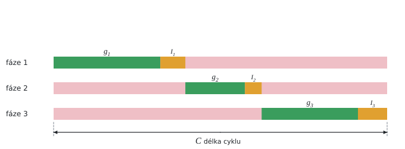

# Délka cyklu světelné signalizace

Teorie k výpočtu, vlastními slovy. Vzorce v rámečcích Kalketa ověřuje.



## Kritický poměr fáze

Saturovaný tok s je největší intenzita, která projede stopčarou při zelené, když fronta vozidel odjíždí bez přerušení (řádově 1 800 vozidel za hodinu na jízdní pruh). V každé fázi rozhoduje proud s největším poměrem skutečné intenzity q k saturovanému toku. To je kritický poměr y = q/s, tedy podíl cyklu, který fáze potřebuje zelenou.

## Websterův vzorec

Webster (1958) odvodil ze simulací zdržení vozidel délku cyklu, při které je zdržení nejmenší:

```kalk
relation C_o == (1.5·L + 5 s)/(1 - Y)
```

L je ztracený čas cyklu (součet mezičasů, kdy nikdo nejede naplno), Y součet kritických poměrů. Krátký cyklus ztrácí moc času na mezičasy, dlouhý nechává vozidla zbytečně čekat. Minimum je ploché, proto se cyklus zaokrouhluje na 5 s. Pro Y → 1 roste cyklus nade všechny meze: křižovatka je na hranici kapacity.

## Rozdělení zelené

Efektivní zelená cyklu C − L se rozdělí úměrně kritickým poměrům. Všechny fáze tak mají stejný stupeň saturace X = Y·C/(C − L):

```kalk
y_1 := 0.3
y_2 := 0.2
Y := y_1 + y_2
C := 60 s
L := 10 s
g_1 := y_1/Y·(C - L)
g_2 := y_2/Y·(C - L)
check "stejný stupeň saturace": abs(y_1·C/g_1 - y_2·C/g_2) ≤ 0.000001
```
