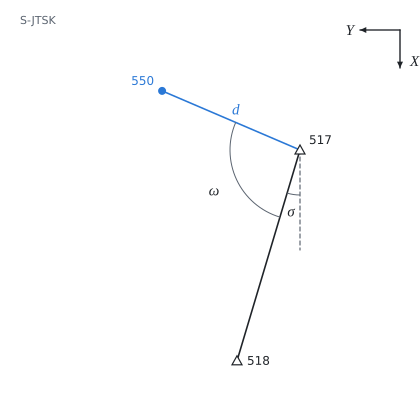

# Radial survey in S-JTSK

The theory behind the calculation, in our own words. Kalketa checks the formulas in the frames.



## The coordinate system S-JTSK

The system of the Unified Trigonometric Cadastral Network is a rectangular plane system of the Krovak projection. The X axis points south, the Y axis west, and both coordinates are positive on the whole territory (Y about 430 to 900 km, X about 930 to 1230 km). The system is right-handed as in mathematics, only rotated: the positive direction of angles is from the X axis to the Y axis, that is clockwise as we look at the map.

## Bearing

The bearing σ is the angle from a parallel to the positive X axis to the line joining two points. It is found from the coordinate differences by the function atan2, which distinguishes the quadrant; the result is converted to the range 0 to 400 gon:

```kalk
relation tan(σ) == ΔY/ΔX
```

```kalk
ΔY := -100 m
ΔX := -100 m
σ := mod(atan2(ΔY, ΔX), 2·π) | gon
check "third quadrant: 250 gon": abs(σ - 250 gon) ≤ 0.00001 gon
```

## Radial survey

At the station horizontal directions are measured with a theodolite. Their zero is arbitrary, so the station is oriented to a known point: the bearing to the new point is the bearing of the orientation plus the angle between the two measured directions. From the bearing α and the horizontal distance d the coordinate increments are:

```kalk
relation ΔY == d·sin(α)
relation ΔX == d·cos(α)
```

The distance is first corrected for physical influences and converted to the projection (by the scale of the Krovak projection and the altitude). In the source this is already done: 286.45 m.
