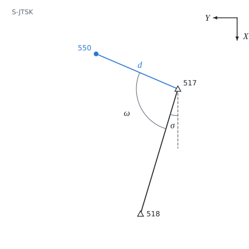

# Rajón v S-JTSK

Teorie k výpočtu, vlastními slovy. Vzorce v rámečcích Kalketa ověřuje.



## Souřadnicový systém S-JTSK

Systém jednotné trigonometrické sítě katastrální je pravoúhlý rovinný systém Křovákova zobrazení. Osa X míří k jihu, osa Y k západu, a obě souřadnice jsou na celém území kladné (Y asi 430 až 900 km, X asi 930 až 1 230 km). Systém je pravotočivý jako v matematice, jen pootočený: kladný směr úhlů je od osy X k ose Y, tedy ve směru hodinových ručiček, jak se díváme na mapu.

## Směrník

Směrník σ je úhel od rovnoběžky s kladnou osou X ke spojnici dvou bodů. Z rozdílů souřadnic se určí funkcí atan2, která rozliší kvadrant; výsledek se převede do rozsahu 0 až 400 gon:

```kalk
relation tan(σ) == ΔY/ΔX
```

```kalk
ΔY := -100 m
ΔX := -100 m
σ := mod(atan2(ΔY, ΔX), 2·π) | gon
check "třetí kvadrant: 250 gon": abs(σ - 250 gon) ≤ 0.00001 gon
```

## Rajón

Na stanovisku se teodolitem měří vodorovné směry. Jejich nula je libovolná, proto se stanovisko orientuje na známý bod: směrník na nový bod je směrník orientace plus úhel mezi oběma měřenými směry. Ze směrníku α a vodorovné délky d jsou přírůstky souřadnic:

```kalk
relation ΔY == d·sin(α)
relation ΔX == d·cos(α)
```

Délka se předtím opraví o fyzikální vlivy a převede do zobrazení (o měřítko Křovákova zobrazení a nadmořskou výšku). Ve zdroji je to už hotové: 286,45 m.

## Kontrola v Pythonu

```python
from math import atan2, sin, cos, pi
gon = pi / 200
X517, Y517 = 1119008.31, 668249.55
X518, Y518 = 1120260.63, 668625.06
sigma = atan2(Y518 - Y517, X518 - X517) % (2 * pi)
omega = (189.2487 - 82.0285) * gon
alpha = sigma + omega
d = 286.45
print("Y =", round(Y517 + d * sin(alpha), 2), " X =", round(X517 + d * cos(alpha), 2))
result("σ", sigma / gon, "gon")
result("ω", omega / gon, "gon")
result("α", alpha / gon, "gon")
result("Y_550", Y517 + d * sin(alpha), "m")
result("X_550", X517 + d * cos(alpha), "m")
```
