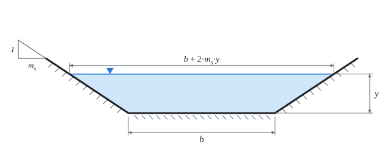

# Uniform flow in an open channel

The theory behind the calculation, in our own words. Kalketa checks the formulas in the frames.



## Uniform flow

In a long prismatic channel (constant shape, slope and roughness) the flow settles so that both the depth and the velocity are constant along the length. The weight of the water along the slope then exactly balances the friction on the wetted perimeter. The depth at which this happens is the **normal depth**.

## Chézy and Manning equations

Chézy (1769): v = C·√(R·I), where R = S/O is the hydraulic radius (flow area divided by wetted perimeter) and I the slope. Manning (1889) gave the velocity coefficient as C = R^(1/6)/n. Together:

```kalk
relation v == R^(2/3)·sqrt(I)/n
relation Q == S·v
```

The roughness coefficient n has the unit s/m^(1/3). Smooth concrete has about 0.012 to 0.015, an earth channel 0.020 to 0.030, an overgrown natural channel 0.05 or more.

```kalk
n := 0.015 s/m^(1/3)
R := 1 m
I := 0.001
v := R^(2/3)·sqrt(I)/n | m/s
check "for R = 1 m, v = √I/n": abs(v - 2.108 m/s) ≤ 0.001 m/s
```

## Trapezoid

For bottom width b, depth y and side slopes 1 : m the flow area is S = (b + m·y)·y and the wetted perimeter O = b + 2·y·√(1 + m²). The discharge grows with depth faster than linearly (the rating curve), but it cannot be solved for the depth in closed form: the normal depth is found by trial or with an equation solver.
