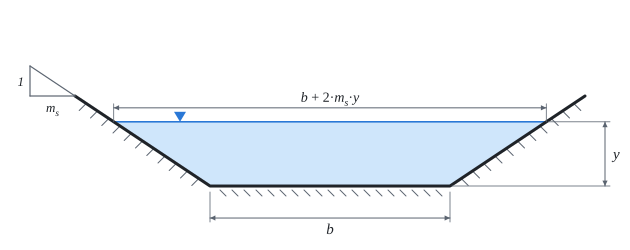

# Rovnoměrné proudění v otevřeném korytě

Teorie k výpočtu, vlastními slovy. Vzorce v rámečcích Kalketa ověřuje.



## Rovnoměrné proudění

V dlouhém prizmatickém korytě (stálý tvar, sklon a drsnost) se proudění ustálí tak, že hloubka i rychlost jsou po délce stálé. Tíha vody ve směru sklonu se pak právě vyrovná tření o omočený obvod. Hloubka, při které to nastane, je **normální hloubka**.

## Chézyho a Manningova rovnice

Chézy (1769): v = C·√(R·I), kde R = S/O je hydraulický poloměr (průtočná plocha děleno omočeným obvodem) a I sklon. Manning (1889) dal rychlostní součinitel jako C = R^(1/6)/n. Spolu:

```kalk
relation v == R^(2/3)·sqrt(I)/n
relation Q == S·v
```

Součinitel drsnosti n má jednotku s/m^(1/3). Hladký beton má asi 0,012 až 0,015, zemní koryto 0,020 až 0,030, zarostlé přirozené koryto 0,05 i víc.

```kalk
n := 0.015 s/m^(1/3)
R := 1 m
I := 0.001
v := R^(2/3)·sqrt(I)/n | m/s
check "pro R = 1 m je v = √I/n": abs(v - 2.108 m/s) ≤ 0.001 m/s
```

## Lichoběžník

Pro šířku dna b, hloubku y a svahy 1 : m je průtočná plocha S = (b + m·y)·y a omočený obvod O = b + 2·y·√(1 + m²). Průtok roste s hloubkou rychleji než lineárně (měrná křivka), ale nelze ho z hloubky vyjádřit obráceně: normální hloubka se hledá zkoušením nebo řešičem rovnic.
