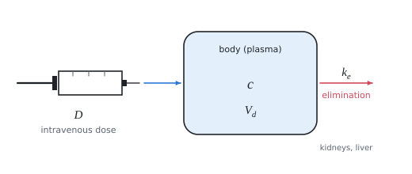

# One-compartment pharmacokinetic model

The theory behind the calculation, in our own words. Kalketa checks the formulas in the frames.



## Model

After an intravenous dose the drug quickly spreads into the blood and the tissues that exchange the substance with the blood quickly. The body then behaves as one vessel (compartment) of apparent volume V_d. With linear (first-order) elimination the substance decreases in proportion to its amount:

```kalk
relation c == c_0·exp(-k_e·t)
```

In a semilogarithmic plot (ln c against t) the measurements lie on a line with slope −k_e. The biological half-life is the time in which the concentration falls to a half:

```kalk
k_e := 0.126 h^-1
t_12 := ln(2)/k_e | h
check "about five and a half hours": abs(t_12 - 5.5 h) ≤ 0.01 h
```

## Volume of distribution and clearance

The apparent volume of distribution is the dose divided by the concentration at time 0 (by extending the line backwards). It is not a real volume: a substance bound in tissues can enlarge it to hundreds of litres. The clearance CL = k_e·V_d is the volume of plasma that is cleared of the substance per unit time.

The area under the concentration curve (AUC) is D/CL for linear kinetics: it equals the integral of the exponential, c_0/k_e.

```kalk
c_0 := 40 mg/L
k_e := 0.126 h^-1
AUC := integral(c_0·exp(-k_e·t), t: 0 h .. 1000 h) | mg·h/L
check "the integral is c_0/k_e": abs(AUC - c_0/k_e) ≤ 0.01 mg·h/L
```

The trapezoidal rule from a few distant points overestimates the area, because the exponential is curved downwards between the points.

## Linearity

Kinetics is linear when k_e, t_1/2, V_d and CL do not depend on the dose and AUC grows in proportion to the dose. When the elimination saturates (enzymes, transporters) this stops being true and the concentration grows faster than the dose.
