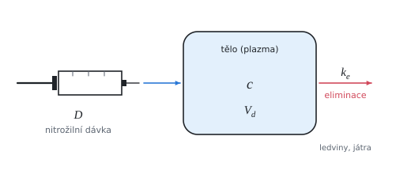

# Jednokompartmentový farmakokinetický model

Teorie k výpočtu, vlastními slovy. Vzorce v rámečcích Kalketa ověřuje.



## Model

Po nitrožilní dávce se léčivo rychle rozptýlí do krve a tkání, které si s krví látku rychle vyměňují. Tělo se pak chová jako jedna nádoba (kompartment) o zdánlivém objemu V_d. Při lineární (prvního řádu) eliminaci ubývá látky úměrně jejímu množství:

```kalk
relation c == c_0·exp(-k_e·t)
```

V semilogaritmickém grafu (ln c proti t) leží měření na přímce se sklonem −k_e. Biologický poločas je čas, za který koncentrace klesne na polovinu:

```kalk
k_e := 0.126 h^-1
t_12 := ln(2)/k_e | h
check "asi pět a půl hodiny": abs(t_12 - 5.5 h) ≤ 0.01 h
```

## Distribuční objem a clearance

Zdánlivý distribuční objem je dávka dělená koncentrací v čase 0 (protažením přímky zpět). Nejde o skutečný objem: látka vázaná v tkáních ho zvětší i na stovky litrů. Clearance CL = k_e·V_d je objem plazmy, který se za jednotku času látky zbaví.

Plocha pod křivkou koncentrace (AUC) je u lineární kinetiky D/CL: rovná se integrálu exponenciály c_0/k_e.

```kalk
c_0 := 40 mg/L
k_e := 0.126 h^-1
AUC := integral(c_0·exp(-k_e·t), t: 0 h .. 1000 h) | mg·h/L
check "integrál je c_0/k_e": abs(AUC - c_0/k_e) ≤ 0.01 mg·h/L
```

Lichoběžníkové pravidlo z několika vzdálených bodů plochu přeceňuje, protože exponenciála je mezi body prohnutá dolů.

## Linearita

Kinetika je lineární, když k_e, t_1/2, V_d a CL nezávisí na dávce a AUC roste úměrně dávce. Při nasycení eliminace (enzymů, transportérů) to přestane platit a koncentrace roste s dávkou rychleji.
