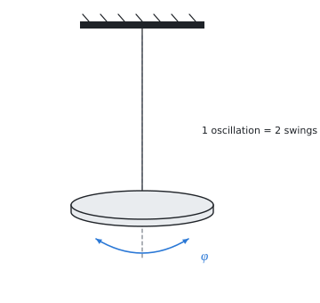

# Measurement uncertainty

The theory behind the calculation, in our own words. Kalketa checks the formulas in the frames.



## Standard uncertainty

A measurement result is given with an uncertainty: an interval in which the true value lies with a given probability. The standard uncertainty is the standard deviation of this distribution (GUM, Guide to the Expression of Uncertainty in Measurement).

**Type A** is determined statistically from repeated measurements. It is the standard deviation of the mean, s/√n:

```kalk
x := [10.1, 10.3, 9.9, 10.2, 10.0] mm
u_A := stdev(x)/sqrt(len(x)) | mm
check "standard deviation of the mean": abs(u_A - 0.0707 mm) ≤ 0.0001 mm
```

**Type B** is determined in another way: from the resolution of the instrument, the accuracy class, a calibration certificate. If only the error limit Δ is known and every value within it is equally probable (uniform distribution), then u_B = Δ/√3.

The **combined uncertainty** of both types is the square root of the sum of squares. The **expanded uncertainty** U = k·u with coverage factor k = 2 covers about 95 % of the values.

## Propagation of uncertainty

If the result is a function of measured quantities, the uncertainties propagate through derivatives (the law of propagation of uncertainty). For a product of powers y = c·x₁^a·x₂^b the relative uncertainties multiplied by the exponents add in quadrature:

```kalk
relation (u_y/y)^2 == (a·u_1/x_1)^2 + (b·u_2/x_2)^2
```

The area of a circle S = π·d²/4 therefore has a relative uncertainty twice that of the diameter.
