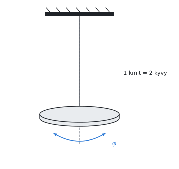

# Nejistota měření

Teorie k výpočtu, vlastními slovy. Vzorce v rámečcích Kalketa ověřuje.



## Standardní nejistota

Výsledek měření se udává s nejistotou: intervalem, ve kterém skutečná hodnota leží s danou pravděpodobností. Standardní nejistota je směrodatná odchylka tohoto rozdělení (GUM, Guide to the Expression of Uncertainty in Measurement).

**Typ A** se určí statisticky z opakovaných měření. Je to směrodatná odchylka průměru, s/√n:

```kalk
x := [10.1, 10.3, 9.9, 10.2, 10.0] mm
u_A := stdev(x)/sqrt(len(x)) | mm
check "směrodatná odchylka průměru": abs(u_A - 0.0707 mm) ≤ 0.0001 mm
```

**Typ B** se určí jinak: z rozlišení přístroje, třídy přesnosti, kalibračního listu. Je-li známa jen mez chyby Δ a každá hodnota v ní stejně pravděpodobná (rovnoměrné rozdělení), je u_B = Δ/√3.

**Kombinovaná nejistota** obou typů je odmocnina ze součtu čtverců. **Rozšířená nejistota** U = k·u s koeficientem k = 2 pokrývá asi 95 % hodnot.

## Šíření nejistoty

Je-li výsledek funkcí měřených veličin, nejistoty se šíří přes derivace (zákon šíření nejistot). Pro součin mocnin y = c·x₁^a·x₂^b se sčítají relativní nejistoty vynásobené exponenty, kvadraticky:

```kalk
relation (u_y/y)^2 == (a·u_1/x_1)^2 + (b·u_2/x_2)^2
```

Plocha kruhu S = π·d²/4 má proto relativní nejistotu dvojnásobnou proti průměru.

## Kontrola v Pythonu

```python
from math import sqrt, pi
t = [18.60, 18.55, 18.60, 18.70, 18.65]
n = len(t)
mean = sum(t) / n
s = sqrt(sum((x - mean) ** 2 for x in t) / (n - 1))
u_A = s / sqrt(n) / 8
u_B = 0.3 / (8 * sqrt(3))
d = 0.81
S = pi * d ** 2 / 4
u_rS = 2 * (0.01 / sqrt(3)) / d
print("T =", round(mean / 8, 4), "s, u =", round(sqrt(u_A ** 2 + u_B ** 2), 4), "s; S =", round(S, 4), "mm², u_r =", round(u_rS * 100, 2), "%")
result("T_k", mean / 8, "s")
result("u_A", u_A, "s")
result("u_B", u_B, "s")
result("u_c", sqrt(u_A ** 2 + u_B ** 2), "s")
result("S_d", S, "mm²")
result("u_rS", u_rS * 100, "%")
result("u_S", S * u_rS, "mm²")
```
